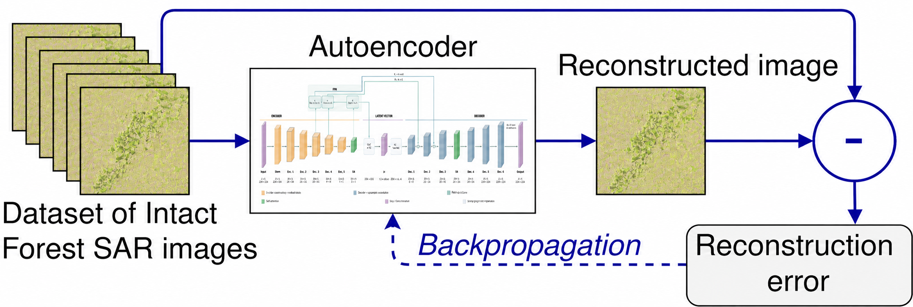
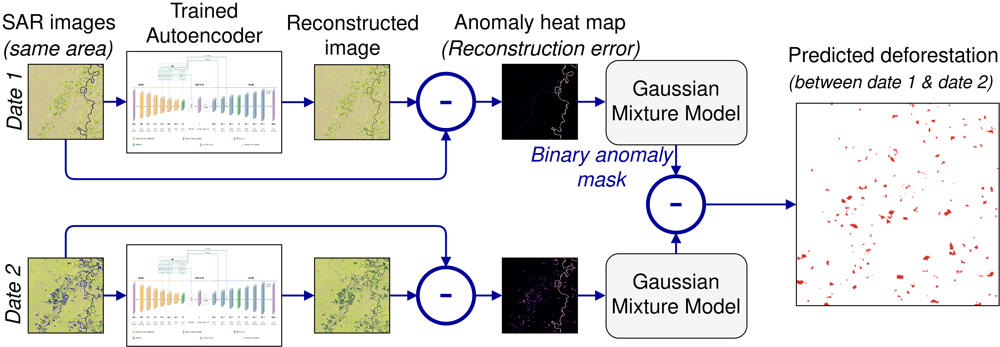

## FADAS methodology

### Training stage

FADAS is trained on intact forest Sentinel-1 SAR imagery to learn the normal
backscatter patterns of forest areas. The autoencoder reconstructs the input
SAR observations, and the reconstruction error between the original and
reconstructed images is minimized during training.

  

  <em>
  Training workflow of FADAS (Forest Anomaly Detection with Autoencoders for
  SAR Imagery). The autoencoder learns to reconstruct intact forest SAR
  observations by minimizing the reconstruction error.
  </em>

### Deforestation detection

At inference time, the trained reconstruction model is applied to Sentinel-1
observations acquired over the same area at two different dates. Reconstruction
errors are used as anomaly heat maps. A Gaussian Mixture Model (GMM) separates
normal and anomalous responses, and the resulting anomaly masks are compared
between the two dates to identify newly appearing forest disturbances.

  

  <em>
  FADAS inference workflow. Reconstruction errors are converted into anomaly
  masks using a Gaussian Mixture Model, and changes between two acquisition
  dates are used to derive the predicted deforestation map.
  </em>

## Dataset

The Sentinel-1 dataset used in this work is available in the repository maintained by Yifan Zhang:

**Dataset repository:**  
https://github.com/ZhangYiFan2003/SAR_Deforestation_Detection_Autoencoder

The dataset contains preprocessed Sentinel-1 VV/VH SAR patches used for training, validation, and testing. The dataset itself is not duplicated in this repository. Users should download or prepare the data following the instructions provided in the dataset repository and update the dataset paths in the scripts accordingly.

## Checkpoints

Pretrained checkpoints for the four reconstruction backbones evaluated in FADAS
are provided:

- FADAS (U-Net)
- FADAS (PSPNet)
- FADAS (SegFormer)
- FADAS (DeepLabV3+)

Each checkpoint corresponds to the model state achieving the lowest validation
reconstruction error during training.

The checkpoints can be used directly to reproduce reconstruction-error maps and
the subsequent deforestation-detection experiments without retraining the
models.

The best model weights are available at:

https://huggingface.co/datasets/saramobsite/FADAS/tree/main

## Scripts

The experiment scripts are provided directly in the main branch of this repository.

### `01_train_reconstruction_models.py`

Trains the four reconstruction backbones evaluated in FADAS:

- SegFormer-B0
- U-Net with ResNet-50 encoder
- PSPNet with ResNet-50 encoder
- DeepLabV3+ with ResNet-50 encoder

All models are trained from scratch using the same train, validation, and test splits and the same normalization settings. The script saves the checkpoint corresponding to the lowest validation reconstruction error and evaluates the selected checkpoint on the complete reconstruction test set.

It also reports reconstruction MSE and RMSE and saves per-sample test reconstruction errors.

### `02_threshold_sweep_and_results.py`

Performs the anomaly-threshold sensitivity analysis used for deforestation mapping.

For each reconstruction backbone, the script:

- uses reconstruction-error maps from the complete test set;
- fits a global two-component Gaussian Mixture Model (GMM);
- computes a global robust reconstruction-error normalization for direct thresholding;
- evaluates GMM posterior thresholding and direct thresholding;
- tests thresholds from 0.5\% to 90\%;
- computes Precision, Recall, F1-score, IoU, Accuracy, TP, FP, FN, and TN;
- evaluates the 2021 and 2022 deforestation periods;
- generates the threshold-sensitivity tables and figures.

